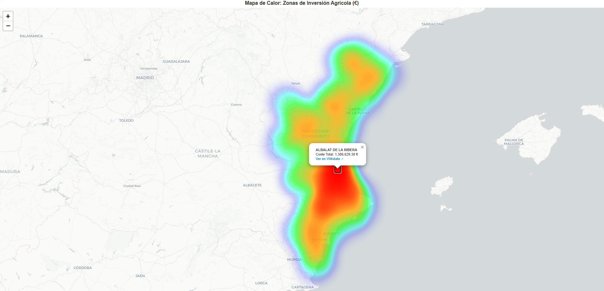
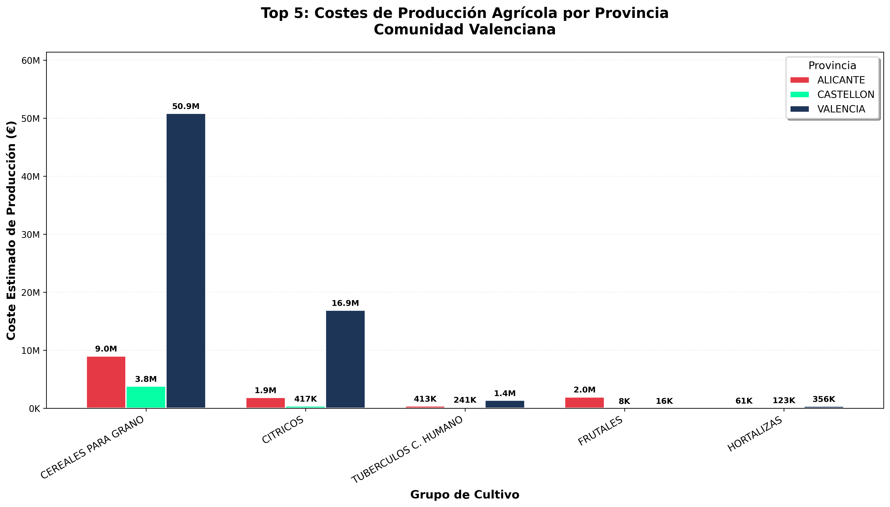

# Semantic Water & Crop Analytics: Valencian Community

## Business Objective

Agriculture in the Valencian Community operates under chronic water stress, yet the data needed to plan around it is scattered across heterogeneous public spreadsheets: water consumption, cultivated area and production costs rarely live in the same place, and almost never in a form that can be queried or joined with external context.

This project turns those fragmented sources into a **queryable Knowledge Graph** that connects water use, cultivated surface and production cost at municipality level. It lets decision-makers (regional planners, water authorities, agri-business analysts) answer questions such as *where is agricultural investment concentrated, which crop groups drive the highest costs, and how do these patterns differ across provinces*, and it does so on an open, reusable data model rather than a one-off report.

---

## Business Value

* **Single source of truth:** Raw public Excel files are consolidated into one semantic model, removing manual reconciliation across sources.
* **Interoperable by design:** Data is modeled with the **Schema.org** vocabulary and linked to **Wikidata**, so it can be combined with any other Linked Data source without custom integration work.
* **Decision-ready geography:** Automatic enrichment with coordinates, population and crop taxonomy turns anonymous rows into geolocated, comparable entities.
* **Trustworthy outputs:** SPARQL-based validation checks the integrity of the generated triples before any analysis is built on top of them.
* **Reproducible pipeline:** The full flow, from raw data to maps and charts, runs end to end with a few commands.

---

## Key Results

Every visualization below is generated directly from SPARQL queries against the RDF graph, not from the original spreadsheets.

### 1. Agricultural Investment Heatmap (€)

An interactive `Folium` map that geolocates municipalities and shows the density of estimated production cost, making investment hotspots visible at a glance.

> **Note:** GitHub does not render interactive maps. The image below is a static preview. To zoom and click through municipalities, download [`mapa_calor_costes.html`](schema/outputs/mapa_calor_costes.html).

| Map Preview |
|:---:|
|  |
| *Heat zones based on total production cost (€).* |

### 2. Top 5 Crops by Production Cost

A comparison across the three provinces (Alicante, Castellón, Valencia) of the crop groups that generate the highest economic cost.

> Charts are generated automatically in `schema/outputs/`.

| Province-Level Breakdown |
|:---:|
|  |
| *Where the largest agricultural investment concentrates across the Valencian Community.* |

---

## Tech Stack

| Layer | Tools |
|---|---|
| **Language** | Python 3.12 |
| **ETL** | Pentaho Data Integration (Kettle) |
| **Semantic Web** | `rdflib`, `SPARQLWrapper` |
| **Ontologies / Linked Data** | Schema.org (`Place`, `Event`, `Product`, `QuantitativeValue`), Wikidata entities and properties |
| **Analysis & Visualization** | `pandas`, `matplotlib`, `seaborn`, `folium` |

**How the pieces fit together**

1. **ETL & cleaning:** Public Excel sources are preprocessed with Pentaho into a clean CSV.
2. **Semantic modeling:** The tabular data is transformed into an RDF graph with `rdflib`.
3. **Linked Data enrichment:** The graph is connected to Wikidata to add coordinates, population and crop taxonomy.
4. **Validation:** SPARQL quality checks verify the integrity of the generated triples.
5. **Visualization:** Maps and charts are produced straight from graph queries.

---

## Repository Structure

```text
.
├── datos/                      # Original data sources (Excel/XLSX)
├── pentaho/                    # ETL processes (.ktr, .kjb) and cleaned CSV
│   └── resultado_proyecto_agua.csv
├── schema/                     # Python source code
│   ├── rdf_transformacion.py       # RDF triple generation
│   ├── enriquecimiento_wikidata.py # Wikidata API enrichment
│   ├── rdf_validation.py           # SPARQL tests and quality checks
│   ├── visualizacion.py            # Map and chart generation
│   └── outputs/                    # RESULTS (graphs and visualizations)
│       ├── datos_agricolas.ttl
│       ├── datos_agricolas_enriquecido.ttl
│       ├── mapa_calor_costes.html
│       ├── grafica_cultivos_top5.png
│       └── image.png
└── README.md
```

---

## Setup & Execution

### 1. Prerequisites

Make sure Python 3.12 is installed, then install the dependencies:

```bash
pip install rdflib SPARQLWrapper pandas matplotlib seaborn folium requests
```

### 2. Run the Pipeline

The pipeline runs sequentially. Execute the commands from the repository root:

**Step 1: Transform to RDF**
Converts the Pentaho-processed CSV into Turtle (`.ttl`) format.

```bash
python schema/rdf_transformacion.py
```

**Step 2: Enrich with Wikidata**
Adds coordinates and external data to the graph.

```bash
python schema/enriquecimiento_wikidata.py
```

**Step 3: Generate Visualizations**
Produces the HTML heatmap and statistical charts in `schema/outputs/`.

```bash
python schema/visualizacion.py
```

**Optional: Validate the Graph**
Runs the SPARQL quality-control checks on the generated triples.

```bash


python schema/rdf_validation.py
```

---

## Collaborators

Developed as a collaborative project at the Universidad de Alicante, BSc in Artificial Intelligence Engineering (2025/26).

- Jesús Cano Moya
- Izan Cuesta Corbí
- Dennis García Solera
- Marcos Segurado Llopis
